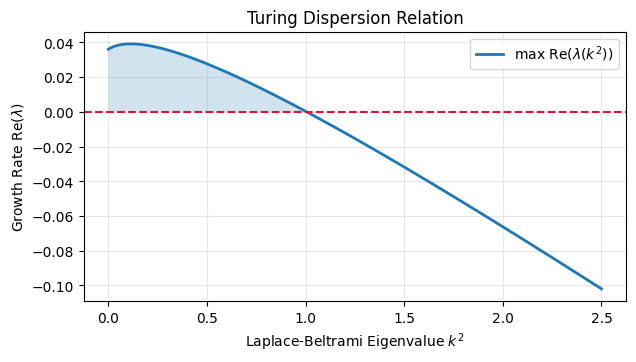

# CUDA-Accelerated Cotangent Laplace-Beltrami Solver for Surface Reaction-Diffusion PDEs


A high-performance **Discrete Differential Geometry (DDG)** and **Sparse Matrix-Vector (CSR SpMV)** PDE solver implemented in **CUDA C++** for simulating coupled non-linear reaction-diffusion systems directly on arbitrary 2-manifold triangle meshes.

---

## 1. Mathematical Formulation

We solve the coupled non-linear Gray-Scott reaction-diffusion partial differential equations on a closed, orientable 2-manifold surface $\mathcal{M} = (V, E, F) \subset \mathbb{R}^3$:

$$\frac{\partial u}{\partial t} = D_u \Delta_{\mathcal{M}} u - u v^2 + F(1 - u)$$

$$\frac{\partial v}{\partial t} = D_v \Delta_{\mathcal{M}} v + u v^2 - (F + k)v$$

where $\Delta_{\mathcal{M}} = \text{div}_{\mathcal{M}} \nabla_{\mathcal{M}}$ denotes the continuous **Laplace-Beltrami operator** on the Riemannian manifold $\mathcal{M}$.

### Linear Stability Analysis & Dispersion Relation (Turing Instability)
Expanding spatial perturbations $\delta \mathbf{w}(\mathbf{x}, t) = \sum_k \mathbf{c}_k e^{\lambda(k^2) t} \phi_k(\mathbf{x})$ in the eigenbasis of the Laplace-Beltrami operator ($-\Delta_{\mathcal{M}} \phi_k = k^2 \phi_k$) yields the linearized dispersion Jacobian:

$$\mathbf{J}(k^2) = \begin{bmatrix} -v_0^2 - F - D_u k^2 & -2 u_0 v_0 \\ v_0^2 & 2 u_0 v_0 - (F + k) - D_v k^2 \end{bmatrix}$$

Diffusion-driven symmetry breaking occurs across the active spatial frequency band where $\max \mathrm{Re}(\lambda(k^2)) > 0$:



---

## 2. Discrete Differential Geometry (Cotangent Formulation)

To ensure geometric invariance across irregular triangle sizes and surface curvature, the spatial operator $\Delta_{\mathcal{M}}$ is discretized via finite-element Galerkin projection with piecewise-linear hat basis functions and barycentric mass lumping ($\mathbf{L} = \mathbf{M}^{-1}\mathbf{W}$):

$$(\Delta_{\mathcal{M}} u)_i = \frac{1}{2 A_i} \sum_{j \in \mathcal{N}(i)} (\cot \alpha_{ij} + \cot \beta_{ij})(u_j - u_i)$$

* **Vectorized Cotangent Assembly:** Interior triangle angles $\alpha_{ij}, \beta_{ij}$ opposite to interior edge $(i, j)$ are evaluated directly via Euclidean vector identities without trigonometric overhead:
  $$\cot \theta = \frac{\mathbf{a} \cdot \mathbf{b}}{\|\mathbf{a} \times \mathbf{b}\|}$$
* **Numerical Conservation:** In the CUDA kernel, the local flux sum $\sum_{j \in \mathcal{N}(i)} w_{ij}(u_j - u_i)$ is accumulated directly in registers rather than subtracting a pre-summed diagonal $W_{ii} u_i$, guaranteeing machine-zero Laplacian evaluation on constant fields in FP32 arithmetic.

---

## 3. CUDA C++ CSR Architecture & Benchmarks

The discrete operator $\mathbf{W}$ on the Stanford Bunny mesh ($|V| = 35,947$ vertices, $|F| = 69,451$ triangles, $\text{nnz} = 207,810$ directed edges) is serialized into **Compressed Sparse Row (CSR)** format and integrated in time using a fused ping-pong **Explicit Forward Euler** CUDA kernel with `__ldg` read-only cache intrinsics.

| Pattern Regime | Feed Rate ($F$) | Kill Rate ($k$) | Time Steps | Execution Time (NVIDIA T4) | Effective Memory Bandwidth |
| :--- | :---: | :---: | :---: | :---: | :---: |
| **Mitosis (Dividing Spots)** | `0.0367` | `0.0649` | `12,000` | `193.35 ms` | `166.03 GB/s` |
| **Soliton / Mixed Spots** | `0.0420` | `0.0630` | `12,000` | `147.91 ms` | `217.04 GB/s` |
| **Labyrinthine Coral Stripes** | `0.0545` | `0.0620` | `12,000` | `148.30 ms` | `216.47 GB/s` |

---

## 4. Repository Structure & Execution

* **`CUDA_Surface_Reaction_Diffusion.ipynb`:** End-to-end executable notebook containing symbolic `SymPy` dispersion analysis, CSR cotangent matrix assembly, inline `nvcc` compilation, and 3D manifold visualization across bifurcation regimes.
* **`surface_rd_solver.cu`:** Standalone CUDA C++ implementation of the fused CSR SpMV and Gray-Scott reaction-diffusion time-stepping kernel.

To compile and run the standalone CUDA solver directly:
```bash
nvcc -O3 surface_rd_solver.cu -o surface_rd_solver
./surface_rd_solver 0.0545 0.0620 sol_coral.bin